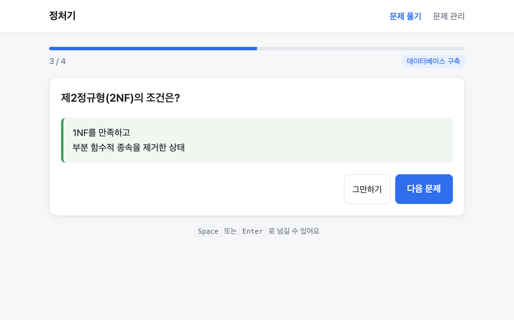
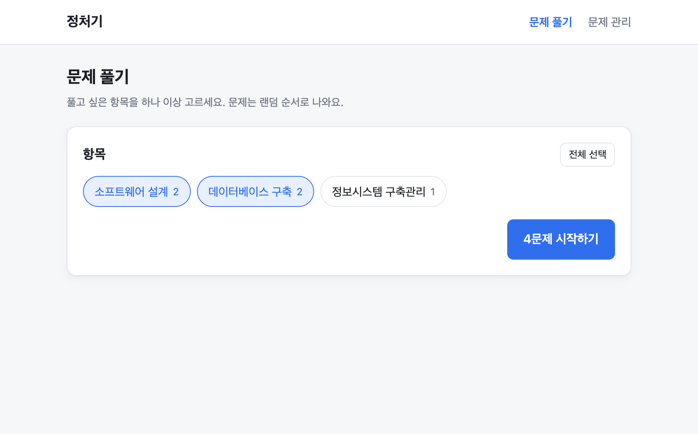
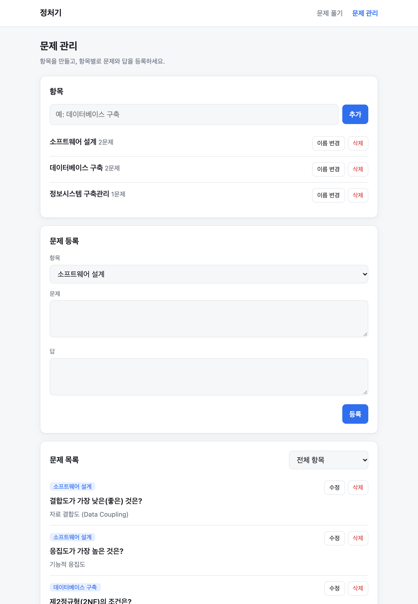

<div align="center">

# 정처기

**내가 만든 문제로 공부하는 정보처리기사 문제 풀이 서비스**

항목별로 문제와 답을 등록하고, 원하는 항목만 골라 랜덤 순서로 풀어보세요.




</div>

<br>

## 주요 기능

- **항목별 문제 관리**: 과목이나 단원 단위로 항목을 만들고, 문제와 답을 등록·수정·삭제할 수 있어요.
- **골라서 풀기**: 항목을 하나만 고를 수도, 여러 개를 섞을 수도 있어요.
- **랜덤 출제**: 시작할 때마다 순서를 새로 섞어서 외운 순서에 기대지 않게 해요.
- **답안 보기 → 다음 문제**: 먼저 떠올려 본 뒤 답을 확인하는 플래시카드 방식이에요.
- **키보드로 진행**: `Space` 또는 `Enter` 키만으로 답을 보고 다음 문제로 넘어가요.
- **가볍게 실행**: DB 서버 없이 JSON 파일 하나에 저장해요. 의존성은 Express 하나뿐이에요.
- **다크 모드 / 모바일 대응**: 시스템 테마를 따르고, 휴대폰에서도 편하게 쓸 수 있어요.

## 스크린샷

| 항목 선택 | 문제 관리 |
|:---:|:---:|
|  |  |

## 시작하기

[Node.js](https://nodejs.org) 20 이상이 필요해요.

```bash
git clone https://github.com/KoulLife/jeong-cheo-gi.git
cd jeong-cheo-gi
npm install
npm start
```

브라우저에서 <http://localhost:3000>을 열면 돼요.

1. 상단의 **문제 관리**에서 항목을 만들고 문제와 답을 등록해요.
2. **문제 풀기**에서 항목을 고르고 **시작하기**를 눌러요.

코드를 고치면서 개발할 때는 `npm run dev`를 쓰면 파일이 바뀔 때 서버가 자동으로 다시 시작돼요.

## 설정

| 환경변수 | 기본값 | 설명 |
|---|---|---|
| `PORT` | `3000` | 서버 포트 |
| `DATA_FILE` | `./data/db.json` | 데이터를 저장할 JSON 파일 경로 |

```bash
PORT=8080 DATA_FILE=/var/lib/jeong-cheo-gi/db.json npm start
```

## 데이터

모든 데이터는 `DATA_FILE` 경로의 JSON 파일 하나에 저장돼요. 파일이 없으면 처음 저장할 때 자동으로 만들어져요.

```json
{
  "categories": [{ "id": "…", "name": "데이터베이스 구축" }],
  "questions": [
    { "id": "…", "categoryId": "…", "question": "트랜잭션의 4가지 특성은?", "answer": "ACID" }
  ]
}
```

백업은 이 파일을 복사해 두면 끝이에요. 저장할 때는 임시 파일에 먼저 쓴 다음 교체하기 때문에, 저장 도중 서버가 꺼져도 파일이 깨지지 않아요.

## API

| 메서드 | 경로 | 설명 |
|---|---|---|
| `GET` | `/api/categories` | 항목 목록 (항목별 문제 수 `count` 포함) |
| `POST` | `/api/categories` | 항목 추가 `{ name }` |
| `PUT` | `/api/categories/:id` | 항목 이름 변경 `{ name }` |
| `DELETE` | `/api/categories/:id` | 항목 삭제 (소속 문제도 함께 삭제) |
| `GET` | `/api/questions?categoryIds=a,b` | 문제 목록 (`categoryIds` 생략 시 전체) |
| `POST` | `/api/questions` | 문제 추가 `{ categoryId, question, answer }` |
| `PUT` | `/api/questions/:id` | 문제 수정 (바꿀 필드만 보내도 돼요) |
| `DELETE` | `/api/questions/:id` | 문제 삭제 |

잘못된 요청에는 `400`, 없는 대상에는 `404`와 함께 `{ "error": "메시지" }`를 돌려줘요.

## 배포할 때 참고

- **영구 디스크가 필요해요.** Vercel이나 Render 무료 플랜처럼 재시작할 때 파일이 초기화되는 환경에서는 데이터가 사라져요. Railway·Fly.io 볼륨이나 VPS처럼 파일이 유지되는 곳에 배포하고, `DATA_FILE`을 그 디스크 경로로 지정하세요.
- **인증 기능이 없어요.** 공개 주소로 배포하면 주소를 아는 누구나 문제를 수정할 수 있어요.

## 프로젝트 구조

```
├── server.js          Express 서버 (정적 파일 + REST API)
├── src/store.js       JSON 파일 저장소
├── public/            프론트엔드 (빌드 없는 바닐라 JS)
│   ├── index.html     문제 풀기
│   ├── manage.html    문제 관리
│   ├── app.js / manage.js / api.js
│   └── style.css
├── test/              node:test 기반 테스트
└── docs/              설계 문서, 스크린샷
```

## 테스트

```bash
npm test
```

## 기여하기

이슈와 PR 모두 환영해요. 큰 변경이라면 먼저 이슈로 이야기를 나눠 주세요.

1. 저장소를 Fork 해요.
2. 브랜치를 만들어요 (`git checkout -b feature/멋진-기능`).
3. 변경 사항을 커밋하고 `npm test`가 통과하는지 확인해요.
4. PR을 열어요.

## 라이선스

[MIT](LICENSE) © Jang Dong Ik
